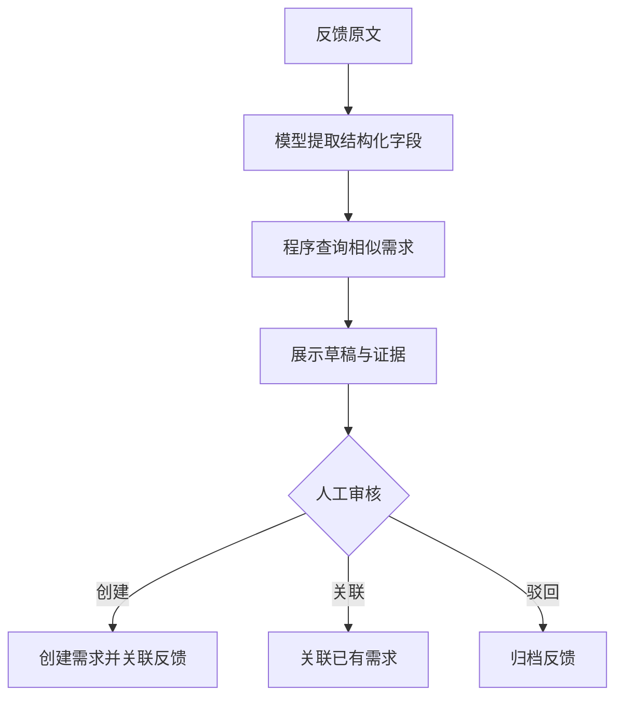

# LangGraph 用户反馈分析与需求分流工作台：从零操作指南

这是面向 AI 产品经理学习的单用户本地原型。先理解业务、跑通流程，再接入模型、做评测，最后扩展为可部署产品。默认模式不调用任何大模型。

## 1. 先理解你要安装什么

LangGraph 是 Python 编程框架，不是登录后拖拽节点的网站。你在 VS Code 写代码，在终端运行程序，在浏览器操作 Streamlit 页面。LangGraph 负责节点执行顺序、分支、状态保存与暂停恢复；模型负责分析自然语言。可以先在自己的电脑运行，不需要购买 LangGraph 托管服务或注册 LangSmith。

与 Dify 的对应关系：

| Dify 中熟悉的内容 | 这里的对应内容 |
| --- | --- |
| 节点 | Python 函数：Node |
| 节点变量 | 共享字典：State |
| 连线、条件分支 | Edge、Conditional Edge |
| LLM 节点 | 一个调用模型 API 的函数 |
| 工作流运行 | 编译 graph 后调用 invoke |
| 人工确认环节 | interrupt 暂停、Command(resume=...) 恢复 |

无需把每个节点都做成独立 Agent，也无需每个节点都调用模型。第一版使用固定工作流；数据库查询、审核和写入由代码处理。动态 Function Calling 留到后续版本。

## 2. 项目为什么值得做

目标用户：负责一个小型软件或校园工具的产品负责人。

输入是散落在问卷、群聊或工单中的用户反馈。输出是经过审核的需求条目与反馈关联关系。它帮助负责人把“看反馈、分类、找重复、整理草稿”这部分工作结构化。

示例原文：每次上传申报材料都要重新填团队信息，能不能记住上次的数据？

系统整理：问题是什么、属于什么类型、原文证据在哪里、是否与已有需求相似、验收条件可以如何表述。未知的影响人数、收入、开发成本与最终优先级，需要人调查或确认。

分类标准：

- bug：已有功能不按预期工作，例如导出报错。
- ux：已有功能可用，但使用麻烦，例如每次要重复填资料。
- feature：希望增加目前没有的能力。
- unclear：信息不足或主要问题不清楚，需要补充。

同一条反馈可能同时涉及体验问题与新功能。在真实评测中，要先约定主要类别的判定规则，记录争议，不能单凭一个标签判断模型错误。

第一版流程：



## 3. 技术栈和作用

| 技术 | 在本项目中的用途 | 第一阶段要理解到什么程度 |
| --- | --- | --- |
| Python 3.12 | 函数、业务逻辑、模型调用 | 会改函数、字典、列表，读懂异常 |
| LangGraph | 状态图、条件分支、暂停恢复 | 能解释 State/Node/Edge/checkpoint |
| OpenAI Python SDK | 调用兼容接口的模型服务 | 会配置 Key、base_url、model |
| Pydantic | 检查输出字段、类别和类型 | 知道 JSON 合法不等于字段正确 |
| SQLite | 保存反馈、需求与审核记录 | 会查表、理解主键与事务 |
| langgraph-checkpoint-sqlite | 持久化流程进度 | 知道 thread_id 用于找到同一任务 |
| Streamlit | 浏览器中展示导入、审核和需求池 | 会添加输入框、表格、按钮 |
| Git | 记录代码版本 | 会提交修改、查看差异 |

后续：Embedding 改善相似需求召回；Langfuse 追踪质量、Token 和耗时；FastAPI 提供独立接口；Docker 统一部署。当前入门包没有实现这些后续功能。

## 4. Windows 安装：按顺序执行

以下命令使用 PowerShell。建议在无空格的路径解压，例如 D:\ai-projects\feedback-workbench。进入包含 app.py、requirements.txt 的那一层，不要停留在外层目录。

1. 从 Python 官方 Windows 下载页安装 Python 3.12 的 Windows 64 位安装程序，保留 Python Launcher。安装后重新打开终端。
2. 安装 VS Code。打开文件夹 feedback-workbench，安装 Microsoft 的 Python 扩展。
3. VS Code 选择“终端 → 新建终端”。以下命令逐行执行。

```powershell
py -3.12 --version
py -3.12 -m venv .venv
.\.venv\Scripts\python.exe -m pip install -r requirements.txt
Copy-Item .env.example .env
.\.venv\Scripts\python.exe hello_graph.py
```

成功标志：最后一条命令打印一个字典，其中 result 包含“收到反馈：希望支持导出 Excel”。这说明 Python 和 LangGraph 已经正常安装。

然后启动页面：

```powershell
.\.venv\Scripts\python.exe -m streamlit run app.py
```

浏览器打开终端显示的本地地址，默认通常是 http://localhost:8501。程序运行时保持终端开启；按 Ctrl+C 可以停止。这里使用虚拟环境 Python 的完整路径，无需修改 PowerShell 执行策略。

VS Code 解释器选择：Ctrl+Shift+P → Python: Select Interpreter → 选择本项目 .venv 内的 python.exe。这样编辑器和运行环境保持一致。

macOS / Linux：

```bash
python3.12 -m venv .venv
.venv/bin/python -m pip install -r requirements.txt
cp .env.example .env
.venv/bin/python hello_graph.py
.venv/bin/python -m streamlit run app.py
```

## 5. 第一次操作：先使用规则演示模式

.env 保持 LLM_MODE=mock，API Key 留空。

1. 在“导入反馈”页输入“希望支持导出 Excel”，点击分析。
2. 在“人工审核”页选择该反馈，检查原文、JSON 草稿和分类。
3. 修改 title 或 acceptance_criteria。evidence 必须保持为原文中的连续片段。
4. 选择创建新需求，提交审核结果。
5. 在“需求池”看到一条新需求。
6. 再输入“希望支持导出表格”，检查候选，选择关联刚才的需求。
7. 需求池仍只有一条需求，feedback_count 变为 2。
8. 输入一条新反馈，分析后先不审核。停止程序，再启动，在人工审核页继续处理。
9. 重复输入同一条无来源 ID 的反馈，确认不会多创建一条需求。
10. 输入“不好用”，审核时选择驳回并归档，确认需求池没有增加。

mock 模式是关键词规则，用于验证流程，不代表 AI 分析效果。sample_feedback.csv 全部是合成演示数据，不能当作真实访谈或真实业务成效。

来源 ID 的含义：它是原始反馈事件的唯一标识，例如问卷记录 ID。不同来源事件可以有相同文本。无 ID 的手动输入按原文去重，适合演示；真实采集应保留事件 ID。

## 6. 切换到真实模型

推荐先用你熟悉的百炼服务，减少同时学习多个服务商的负担。

1. 按官方“获取与配置 API Key”文档进入百炼控制台，开通模型服务并创建 API Key。
2. 记录该 Key 所属地域、该空间的 OpenAI 兼容 base_url 和可调用的模型 ID。
3. 在 VS Code 中打开 .env，填写配置。

```dotenv
LLM_MODE=real
LLM_API_KEY=填写你自己的模型服务APIKey
LLM_BASE_URL=填写控制台对应地域的OpenAI兼容base_url
LLM_MODEL=填写可调用且支持JSON输出的模型ID
LLM_DISABLE_THINKING=true
DATA_DIR=data
```

北京地域业务空间专属地址格式是 https://你的WorkspaceId.cn-beijing.maas.aliyuncs.com/compatible-mode/v1。API Key 与地址必须属于同一地域；SDK 的 base_url 不要加 /chat/completions。

入门包 .env.example 给出的旧北京地域地址是官方仍支持的兼容地址，官方建议使用空间专属域名。模型 ID 示例是 qwen-plus；请以自己的控制台实际权限为准。此模型系列的 JSON Object 模式应使用非思考模式，因此代码在 LLM_DISABLE_THINKING=true 时加入 enable_thinking=false。换其他服务商时，按其文档决定是否将该字段改为 false。

4. 停止并重启 Streamlit。
5. 页面应显示真实模型模式。使用新的来源 ID 测试一条反馈，例如 real-001，避免命中之前的 mock 记录。
6. 到处理记录检查分析方式、模型名称、耗时和返回的 Token 用量。

已有反馈保存了首次使用的分析方式，切换配置不会自动重算旧反馈。要做同一文本的多版本实验，请使用不同实验来源 ID 或不同 DATA_DIR，并保留测试集版本。

模型调用由你配置的服务商按账号规则计费。无需将 Key 发到聊天中；.env 已加入 .gitignore。

当前代码使用 JSON Object＋Pydantic 校验。JSON Object 保证格式的模型能力，不保证全部字段符合要求；代码会拒绝字段异常或伪造证据。遇到错误会保留任务，允许显式重试；SDK 最多自动重试一次部分连接或服务异常，调用失败也可能计费。入门版日志并非完整账单，Token 记录不能替代服务商账单。

## 7. 代码按这个顺序阅读

| 文件 | 读懂后回答的问题 |
| --- | --- |
| hello_graph.py | 怎样把两个端点和一个函数连成图？ |
| models.py | 允许哪些字段？什么输出会被拒绝？ |
| workflow.py | 每个节点读写哪些 State 字段？流程在哪里暂停？ |
| storage.py | 查询和写库如何发生？怎样避免重复写入？ |
| app.py | 页面按钮如何调用流程？ |
| test_workflow.py | 怎样验证审核、恢复和异常路径？ |

State 是共享数据。例如：text 保存反馈原文，analysis 保存提取结果，candidates 保存检索候选，draft 保存人工待审内容，review 保存决策，outcome 保存执行结果。

Node 是一个函数，接收 State，返回要更新的字段。analyze 调模型；retrieve 调数据库工具；review 暂停等人；save 执行写库。

Edge 决定下一步。审核选择 create/link 时去 save，reject 时去 archive_rejected。创建或关联的分支由写库工具明确执行，不让模型自由生成 SQL。

Checkpoint 是任务进度的持久化记录。thread_id 绑定一条反馈的流程。恢复必须用同一 ID；仅用内存状态无法跨进程恢复。

interrupt 会在恢复时重新进入它所在的节点，所以入门包将业务写库放在后续节点。数据库事务和反馈唯一关联保证同一次写入重试不会多创建需求。

business.sqlite 保存业务记录，checkpoints.sqlite 保存流程进度。两者都在 data 目录；新项目初次运行会自动建立。

## 8. 十天执行清单

| 天数 | 做什么 | 当天验收 |
| --- | --- | --- |
| 第 1 天 | 安装环境，跑 hello_graph 和 mock 页面 | 页面打开，完成一次人工审核 |
| 第 2 天 | Python 字典、函数、列表、异常；改一条输出字段 | 能解释 State 和 Node |
| 第 3 天 | 定义目标用户、反馈分类和 3 个典型场景；写 2 页 PRD | 明确输入、输出、人工权限与验收标准 |
| 第 4 天 | 接入真实模型，检查 JSON、证据和 Token | 10 条反馈分析可运行，记录失败原因 |
| 第 5 天 | 学 SQL 查询与主键，试创建／关联／重复提交 | 能说明两种去重：事件幂等与语义重复 |
| 第 6 天 | 学 interrupt、thread_id、checkpoint；做停止恢复实验 | 重启后能继续待审核任务 |
| 第 7 天 | 收集 50—100 条有来源的反馈并人工标注 | 保存来源、类别、重复关系与争议记录 |
| 第 8 天 | 加 Embedding 候选召回，与字符基线比较 | 固定需求库，测试候选召回是否改善 |
| 第 9 天 | 在独立测试集评测；找 3—5 位用户试用 | 记录正确性、时间与使用障碍 |
| 第 10 天 | 修复高频问题，录演示，整理版本复盘 | 3 分钟演示＋PRD＋评测结果 |

如果第一次接触 Python，给第 2、4、5 天增加时间。按验收推进，不必为了日期跳过无法理解的逻辑。

每天建议：2 小时基础学习，4 小时实现和调试，1 小时评测，1 小时产品文档或访谈。每次只改一个核心功能，记录预期与结果。

## 9. 后续怎样把项目做得更有竞争力

V0（入门包已有）：规则演示、单条／CSV 输入、固定模型分析节点、相似文本候选、人工编辑审批、创建／关联／驳回、SQLite 检查点、事件日志、JSON 导出。

V1：启用真实模型，明确类别判定标准；引入真实反馈与人工标签；改善歧义处理和缺失信息提示。首次上线目标是帮助人完成任务，而不是自动替人决定优先级。

V2：Embedding 召回相似需求，比较字符基线。先查询 Top K 候选，人工确认重复；用开发集调参数、保留测试集验收。小数据可先本地计算余弦相似度，不必立即购买向量数据库。

V3：按需要加入 Function Calling。向模型提供 search_requirements/get_requirement 等工具 schema，让模型返回工具名和参数，代码校验并执行，然后把工具结果回传模型。限制轮数与超时。需求写入继续经过人工审核，模型不直接执行任意 SQL。当前入门包只是固定流程显式调用工具，并未实现模型自主选工具。

V4：接入 Langfuse 或等价观测，记录每次调用、提示词版本、测试集版本、耗时与用量；加入失败案例回归。FastAPI、Docker、用户鉴权和部署在核心功能与评测稳定后再做。此包是单用户本地学习原型，尚不适合作为多人生产服务直接公开。

MCP 可以放在需要把工具共享给多个 AI 客户端时研究。只为了内部查询一个数据库，普通函数已经够用。

## 10. 评测怎么做

先固定任务与需求库快照。建议第一批 60 条，20 条开发集用于提示词修改，40 条保留测试集用于验收。相同问题的改写尽量按问题组划分，避免同一需求的近似改写同时出现在开发集与测试集中。

| 指标 | 计算或核验方式 |
| --- | --- |
| 分类准确率／macro-F1 | 与人工标签比较；记录类别不均衡和争议 |
| Recall@5 | 应有重复需求的查询中，正确需求是否在前 5 候选；分母只包含有已知重复的查询 |
| 证据有效率 | 引用能在原文找到，且确实支持相关判断；逐字匹配只是第一层检查 |
| 人工接受率 | 草稿是否无需实质修改即可使用，先定义“实质修改” |
| 处理时间 | 相同难度反馈的人工整理用时，与使用工具整理用时比较；包含审核时间 |
| 操作正确性 | 未审批不创建、重复不多写、驳回不入池、重启后可恢复 |
| 成本和延迟 | 记录成功与失败调用，模型价格版本；报告任务耗时和每个成功任务成本 |

evaluation_template.csv 是空白记录模板，不包含已测结果。先做人工标注，再填写各版本输出。合成演示数据与真实反馈分开报告。小样本结果只用于项目验证，不声称线上大规模效果。

这属于离线评测／小规模试用；没有线上随机分流实验时，不写成线上 A/B 测试。

## 11. 常见错误

| 现象 | 先检查什么 |
| --- | --- |
| py 命令不可用 | 是否安装 Python Launcher，安装后是否重开终端；也可用安装目录中的 python.exe |
| No module named langgraph | 是否用 .venv 的 python 安装并运行，requirements 是否安装成功 |
| requirements.txt 找不到 | 终端是不是位于包含 app.py 的文件夹 |
| 模型返回 401/403 | Key 是否正确、是否属于同一地域、模型权限是否开通 |
| 模型返回 404 | base_url 与 model 是否正确，是否误把完整聊天路径填为 base_url |
| JSON 输出异常 | 模型是否支持 JSON Object；qwen-plus 是否关闭思考模式；不要把字段错误当成成功 |
| 改成 real 仍看到 mock 结果 | 重启程序，用新的来源 ID；旧任务保留原始分析方式 |
| 重启后找不到任务 | DATA_DIR 是否变化，是否误删 data，是否用了不同 thread_id |
| 相似候选没命中 | 字符基线无法稳定识别同义改写；先检查需求池，再进入 Embedding 优化 |

验证命令：

```powershell
.\.venv\Scripts\python.exe -m unittest -v test_workflow.py
```

也可用命令行观察暂停恢复：

```powershell
.\.venv\Scripts\python.exe demo_cli.py start "希望支持导出 Excel"
.\.venv\Scripts\python.exe demo_cli.py resume 上一步输出的feedback_id --action create
.\.venv\Scripts\python.exe demo_cli.py list
```

## 12. 官方学习入口与验证范围

- [Python Windows 下载](https://www.python.org/downloads/windows/)
- [VS Code 下载](https://code.visualstudio.com/download)
- [LangGraph 安装](https://docs.langchain.com/oss/python/langgraph/install)
- [LangGraph Graph API](https://docs.langchain.com/oss/python/langgraph/graph-api)
- [LangGraph Interrupts](https://docs.langchain.com/oss/python/langgraph/interrupts)
- [LangGraph Persistence](https://docs.langchain.com/oss/python/langgraph/persistence)
- [百炼 API Key](https://help.aliyun.com/zh/model-studio/get-api-key)
- [百炼 OpenAI 兼容接口](https://help.aliyun.com/zh/model-studio/compatibility-of-openai-with-dashscope)
- [百炼结构化输出](https://help.aliyun.com/zh/model-studio/qwen-structured-output)
- [Streamlit 安装](https://docs.streamlit.io/get-started/installation/command-line)

优先阅读 Graph API 中的 State、Node、Edge，以及 Interrupts 中的暂停与恢复示例。先掌握这一小组 API，再看高级并发和长期记忆。

验证记录见 VALIDATION.md。真实服务的 Key、权限、费用和效果需要在你自己的账号中验证。


## 本机连接稳定性（2026-10-08）

已提供独立后台启动和持久日志。在项目目录运行 .\.venv\Scripts\python.exe start_app.py --port 8502，然后打开 http://127.0.0.1:8502。现有服务占用端口时不会重复启动。断连原因、验证记录及备份位置见 CONNECTION_STABILITY.md。
